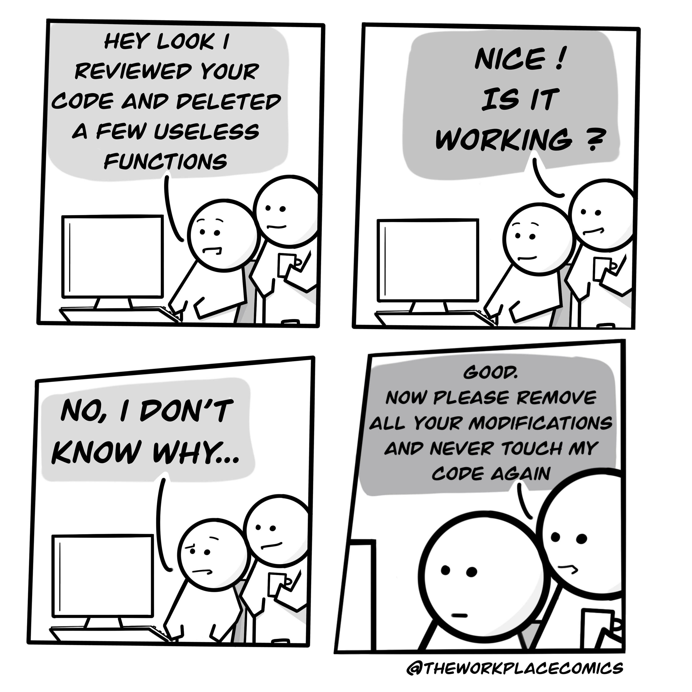
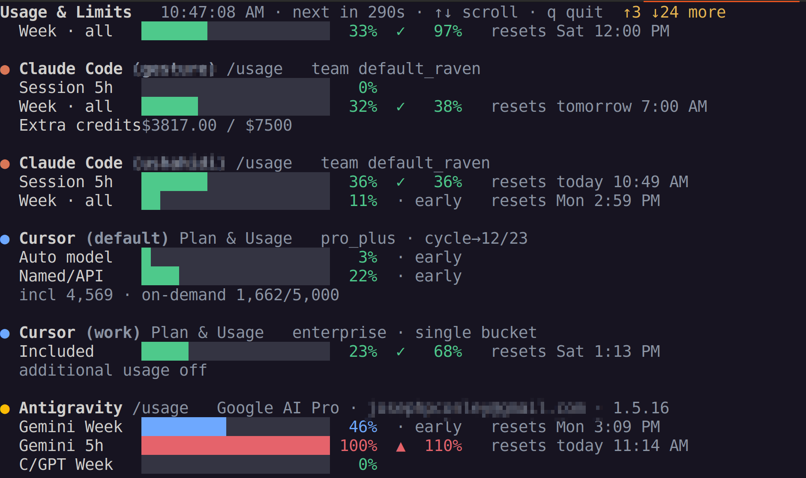

[https://github.com/josephpconley/pr-overseer](https://github.com/josephpconley/pr-overseer)

<table class="image">
	<caption align="bottom">Source: <a href="https://www.reddit.com/r/ProgrammerHumor/comments/lxk09d/code_reviews/" target="_blank">r/ProgrammerHumor</a></caption>
	<tr><td></td></tr>
</table>

In keeping with my long tradition of building my own tools rather than just paying for one (see [simple invoicing]()), I wrote a code reviewer. There are plenty of great AI review bots out there. But I was already paying for several coding agents (Claude Code, Cursor, Muse, Antigravity), and I wanted them to check each other's work.

So meet [PR Overseer](https://github.com/josephpconley/pr-overseer), a Python script on a cron job that runs every 15 minutes on a local networked machine. It looks for open PRs across a list of repos, checks each one out into a throwaway git worktree, and hands it to one of those agent CLIs in read-only mode for a review. The review then gets posted to GitHub as an approval or a request for changes.

## How it works

There are two modes per repo:

- **review**: reviews PRs where I'm a requested reviewer. Posts the review, never merges.
- **self_review**: also reviews my own PRs, and if the verdict is APPROVE and _every_ CI check is green, merges it.

A typical tick looks like this:

1. Find PRs that need a review (and skip the ones already reviewed)
2. Pick a harness, i.e. one of the coding agents, in priority order, with cooldowns and failover when one hits a quota limit
3. Pick a model tier (`everyday` or `deep`) based on what the PR touches
4. Run the review, post it, label the PR (`review: approved`, `review: changes requested`, etc.)
5. Merge if allowed, or flag it for a human if it looks risky

There's also a daily Dependabot triage (merge the safe bumps, comment on the rest) and a weekly job that finds my slowest and least useful tests and opens a PR to speed up or delete them.

## Takeaways

### Don't let a model grade its own homework

The one hard rule: **the overseer never reviews a PR with the model that made the latest commit**. Greptile showed that models don't do a great job at [self-review](https://www.greptile.com/blog/model-inversion), so overseer reads commit trailers, author emails, and the usual "Generated with Claude Code" footprints to figure out who wrote what. If Cursor wrote it, Claude or Gemini reviews it. If the only agents left are the author, the PR waits for the next tick rather than getting a rubber stamp.

It's the same principle as human code review. A fresh set of eyes catches what the author can't see, and different models really do have different blind spots.

### Not every PR deserves the big model

A README typo doesn't need the most expensive model on the planet. Simple rules sort most PRs: anything touching auth, secrets, CI workflows, infrastructure, schemas or billing, or any large diff, gets the `deep` tier. Docs and small diffs get `everyday`. A cheap classifier model handles the gray area in between. If anything goes wrong in that step, it defaults to `deep`, so a classifier hiccup never makes a review weaker.

### Fail closed, and keep a human in the loop

As the Claude Code team notes, it's important to keep a [human in the loop](https://claude.com/resources/webinars/how-the-claude-code-team-does-code-review), and overseer is no exception. Really risky or really large PRs get a "soft approval" plus an email to me, and the merge is held until I review and release it. 

Most of the work here was guardrails, not prompts. No merge without all-green CI on the exact commit that was reviewed, and other repo-specific rules and company policies where needed.

The AI part is honestly the easy part. Deciding what the AI is _allowed_ to do is where the engineering happens.

It also helps to have a centralized view of all of your AI usage - saved me more than once debugging why I kept running out of a specific model.

<table class="image">
	<tr><td></td></tr>
</table>

## Next Steps

- Trying an open-source model (something like `qwen3-coder` via Ollama) for the tier classifier, so it doesn't burn paid quota - I tested using [Pi](https://pi.dev/) and so far results were slow but promising
- Turning on automatic fixes for my own PRs more broadly: the overseer can already push a fix for its own review feedback, but I've kept that switched off by default for now
- Packaging it up so it's easier to run outside my own machine

## Suggestions?

Let me know what you think and if you have any suggestions. Thanks!
